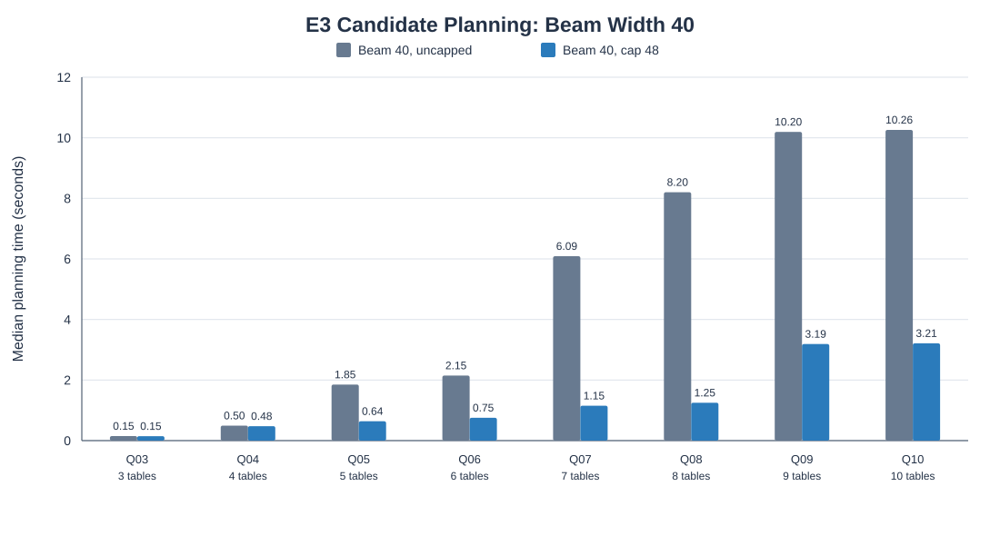
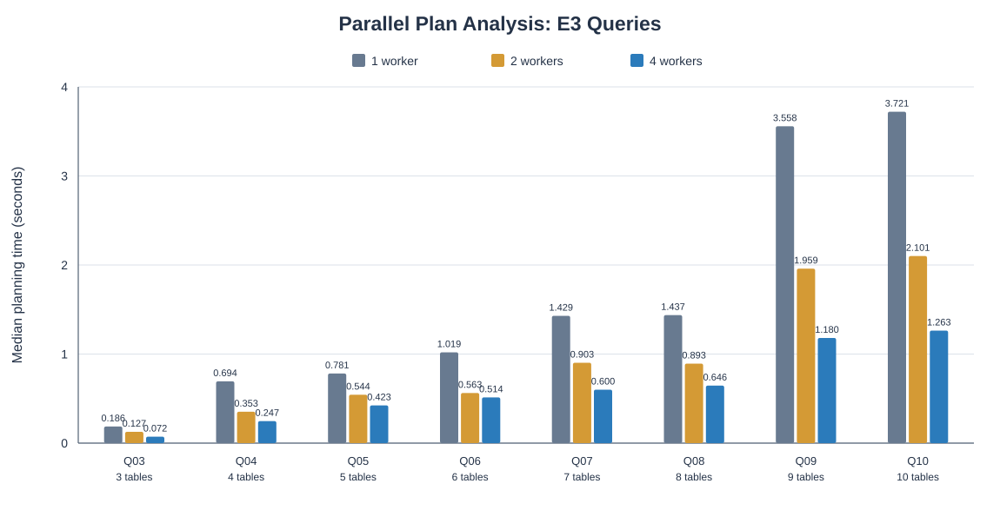

# 4.1 Scalable Candidate Search and Planning Overhead

## Objective

This experiment evaluates whether bounded join-order search and inexpensive
candidate pre-scoring reduce the time spent generating and analyzing physical
plan candidates. The workload consists of eight E3 SQL queries covering three
through ten joined tables.

## Experimental Setup

The planning scalability benchmark used the project's local TPC-DS-derived
`full_sf10/parquet` data for the core tables and local E3 parquet data for the
additional relations. This dataset should not be described as the complete
official TPC-DS SF10 dataset.

The Spark configuration was held constant across configurations:

- Spark 4.2.0, `local[2]`
- Adaptive Query Execution disabled
- Cost-Based Optimization disabled
- CBO join reordering disabled
- Automatic broadcast-join threshold set to -1
- One candidate-analysis worker
- Three measured repetitions per configuration, following warm-up runs

The comparison was between beam search with width 40 and no pre-scoring cap,
and beam search with width 40 and a candidate-analysis cap of 48. This is an
uncapped-beam baseline, not exhaustive join-order search.

The benchmark measured planning only; it did not execute the E3 queries.

## Planning-Time Results

| Query | Tables | Uncapped beam median (s) | Cap 48 median (s) | Time saved |
|---|---:|---:|---:|---:|
| Q03 | 3 | 0.149 | 0.148 | 0.5% |
| Q04 | 4 | 0.496 | 0.478 | 3.8% |
| Q05 | 5 | 1.851 | 0.639 | 65.5% |
| Q06 | 6 | 2.149 | 0.752 | 65.0% |
| Q07 | 7 | 6.089 | 1.151 | 81.1% |
| Q08 | 8 | 8.203 | 1.252 | 84.7% |
| Q09 | 9 | 10.195 | 3.190 | 68.7% |
| Q10 | 10 | 10.261 | 3.212 | 68.7% |

The mean of the per-query savings percentages for Q05–Q10 was approximately
72.3%. The largest reduction was observed for Q08, at 84.7%.

For Q03, 16 SQL variants were generated and all 16 were analyzed in both
configurations. For Q04, 48 variants were generated and all 48 were analyzed
in both configurations. Therefore, their small timing differences do not
represent meaningful savings from candidate pruning.

For Q05–Q10, 164 SQL variants were generated in the uncapped configuration
and 48 were analyzed with cap 48. The corresponding unique physical-plan
counts fell from 123 to 46. There were no candidate-analysis errors in the
measured runs.

## Parallel Physical-Plan Analysis

A follow-up planning-only experiment held beam width 40 and the candidate-analysis cap at 48 while testing 1, 2, and 4 candidate-analysis workers. The Spark configuration remained `local[2]`, and each configuration used one warm-up followed by three measured repetitions. The queries themselves were not executed.

| Query | Tables | 1 worker (s) | 2 workers (s) | 4 workers (s) | Time saved with 4 workers |
|---|---:|---:|---:|---:|---:|
| Q03 | 3 | 0.186 | 0.127 | 0.072 | 61.31% |
| Q04 | 4 | 0.694 | 0.353 | 0.247 | 64.41% |
| Q05 | 5 | 0.781 | 0.544 | 0.423 | 45.79% |
| Q06 | 6 | 1.019 | 0.563 | 0.514 | 49.62% |
| Q07 | 7 | 1.429 | 0.903 | 0.600 | 57.99% |
| Q08 | 8 | 1.437 | 0.893 | 0.646 | 55.06% |
| Q09 | 9 | 3.558 | 1.959 | 1.180 | 66.83% |
| Q10 | 10 | 3.721 | 2.101 | 1.263 | 66.05% |

The average of the per-query planning-time reductions with four workers was approximately 58.4%. All queries completed below three seconds with four workers, including Q09 and Q10, which exceeded that target in the earlier single-worker experiment.

Plan counts were consistent: 12 for Q03, 36 for Q04, and 46 for Q05–Q10. No candidate-analysis errors occurred, and fingerprints were stable across the three repetitions within each worker configuration. This experiment validates planning latency; it does not establish the execution-quality target across all eight queries.

## Execution-Quality Check for Q05

A separate execution-quality experiment used the five-table Q05 query against
the local representative parquet dataset. Exhaustive candidate generation
produced 144 unique physical plans. Each plan had five valid measured
executions with equivalent query results.

The exhaustive-best plan was
`join_order_ss_i_cd_s_d_broadcast`, with a median execution time of
0.114826 seconds. A beam-width-40, cap-48 candidate set retained that same
physical-plan fingerprint. Its best observed execution time therefore had
0% loss relative to the exhaustive-best candidate in this experiment.

Repeated planning runs on that representative dataset produced stable
fingerprint sets. Median planning time was 2.866 seconds for exhaustive
candidate generation and 0.644 seconds for beam width 40 with cap 48, a
77.5% reduction.

This execution-quality result applies to Q05 on the representative dataset
only. It does not establish a 3% execution-loss bound for Q03–Q10 or for the
separate full-SF10-derived scalability dataset. The predictor's ability to
select the best candidate is also not established by candidate retention alone.

## Implementation and Cache Decision

Pre-scoring is a lightweight heuristic to reduce the number of SQL variants
sent to Spark; it is not an execution-latency predictor.

AST reuse has also reduced repeated SQL parsing overhead in the candidate
generator. An initial LRU plan-template-cache prototype did not show a
measurable benefit after AST reuse (approximately 29.027 ms uncached versus
29.052 ms cached in the recorded microbenchmark), so that cache was not
adopted.

## Limitations and Remaining Work

- The three-repetition planning experiment reports medians, but broader
  repetition counts would strengthen the timing estimates.
- In the initial single-worker cap-48 experiment, Q09 and Q10 took 3.190
  and 3.212 seconds. The subsequent parallel-analysis experiment brought
  them below three seconds with four candidate-analysis workers.
- The 3% execution-quality target has only been demonstrated for Q05 on the
  representative dataset. Other queries and larger-data execution quality
  remain unvalidated.
- The local `full_sf10` path contains a partial TPC-DS-derived dataset and
  must not be presented as a complete official SF10 dataset.
- Candidate generation, pruning quality, and the predictor's final selection
  are different evaluation stages and should be reported separately.

## Reproducibility Artifacts

- Planning runner: `experiments/benchmark_e3_beam40_cap48.py`
- Planning measurements:
  `results/e3/beam40_cap48/prescoring_all_runs.csv`
- Planning summary:
  `results/e3/beam40_cap48/prescoring_all_summary.csv`
- Q05 exhaustive execution measurements:
  `results/e3/exhaustive_prescoring_q05_runs.csv`
- Q05 exhaustive/pre-scoring quality summary:
  `results/e3/exhaustive_prescoring_q05_summary.csv`
- Q05 cap sweep:
  `results/e3/exhaustive_prescoring_q05_cap_sweep.csv`
- All-query parallel-analysis runner:
  `experiments/benchmark_e3_parallel_workers_all.py`
- Q09/Q10 parallel-analysis diagnostic:
  `experiments/benchmark_e3_parallel_workers.py`
- Parallel-analysis measurements:
  `results/e3/beam40_cap48/parallel_workers_all_runs.csv`
- Parallel-analysis summary:
  `results/e3/beam40_cap48/parallel_workers_all_summary.csv`
- Parallel-analysis chart:
  `results/e3/beam40_cap48/parallel_worker_comparison.svg`
- Q05 cap-48 repeatability:
  `results/e3/exhaustive_prescoring_q05_cap48_repeat_runs.csv`
